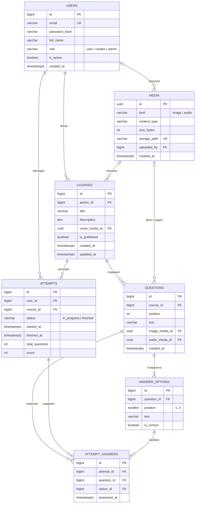

# Схема базы данных

СУБД: PostgreSQL 16. Источник правды — модели `backend/app/models/` и миграции `backend/migrations/versions/`.
Справочный SQL (получен из миграции, только для чтения): [`schema.sql`](schema.sql).
Владелец схемы: БД (Горленко). Бэкенд вносит изменения схемы только через PR к миграциям.

## ER-диаграмма



## Таблицы

| Таблица | Назначение |
|---|---|
| `users` | Пользователи и их роль (RBAC). Пароль хранится только в виде хэша |
| `media` | Метаданные загруженных фото и аудио. Сами файлы лежат на диске (`MEDIA_DIR`, в Docker — том `media_data`) |
| `courses` | Курсы. Опубликованные видны всем, черновики — автору и администратору |
| `questions` | Вопросы курса: текст + необязательные фото и аудио, порядок `position` |
| `answer_options` | Варианты ответа вопроса (всегда 4, один правильный) |
| `attempts` | Попытка прохождения курса пользователем |
| `attempt_answers` | Ответы пользователя в рамках попытки |

## Нормализация

Схема в третьей нормальной форме: каждый факт хранится в одном месте, правильность ответа не дублируется
(`attempt_answers` не хранит `is_correct`, а берёт его из `answer_options`).
Две осознанные денормализации в `attempts`: `total_questions` и `score` фиксируются при старте и завершении попытки,
чтобы результат не менялся, если автор позже правит курс.

## Целостность данных

**Внешние ключи и каскады**

| Связь | При удалении родителя |
|---|---|
| `courses.author_id → users` | `RESTRICT` (пользователей не удаляем, а блокируем: `is_active = false`) |
| `questions.course_id → courses`, `answer_options.question_id → questions` | `CASCADE` |
| `attempts.course_id → courses`, `attempts.user_id → users` | `CASCADE` |
| `attempt_answers.*` | `CASCADE` по попытке, вопросу и варианту |
| `courses.cover_media_id`, `questions.image_media_id / audio_media_id`, `media.uploaded_by` | `SET NULL` |

**Ограничения (проверяются самой БД)**

- `users.email` уникален без учёта регистра (индекс по `lower(email)`); роль только `user`, `creator` или `admin`.
- `answer_options`: позиция 1–4; уникальна пара (вопрос, позиция); **не более одного правильного варианта на вопрос** (частичный уникальный индекс).
- `attempt_answers`: один ответ на вопрос в попытке; **составной внешний ключ (`option_id`, `question_id`)** не даёт выбрать вариант чужого вопроса.
- `attempts`: статус `in_progress` — нет `finished_at` и `score`; статус `finished` — оба заполнены; `0 ≤ score ≤ total_questions`.
- `questions`: уникальная пара (курс, позиция), `DEFERRABLE INITIALLY DEFERRED` — порядок вопросов можно менять в одной транзакции (например, поменять два вопроса местами).
- `media`: `kind` только `image` или `audio`, размер больше нуля.

**Что БД не проверяет и должен проверять бэкенд**

- У вопроса ровно 4 варианта и ровно один правильный (БД гарантирует «не больше одного», остальное — API внутри транзакции).
- Вопрос в ответе принадлежит курсу этой попытки.
- Попытка принадлежит текущему пользователю и ещё не завершена.
- Курс нельзя опубликовать без вопросов.

## Индексы для поиска и выборок

| Индекс | Зачем |
|---|---|
| `ix_users_email_trgm`, `ix_users_full_name_trgm` (GIN, `pg_trgm`) | Поиск пользователей по подстроке в админке |
| `ix_courses_title_trgm`, `ix_courses_description_trgm` (GIN, `pg_trgm`) | Поиск курсов в каталоге |
| `ix_courses_published_created` (частичный, `WHERE is_published`) | Каталог опубликованных курсов, новые первыми |
| `ix_courses_author_id` | «Мои курсы» |
| `ix_attempts_user_started` (`user_id`, `started_at DESC`) | История попыток пользователя |
| `ix_attempts_course_id` | Статистика курса |
| `ix_attempt_answers_question_id` | Статистика по вопросам |
| `ix_users_role` | Фильтр пользователей по роли |

## Подсказки для бэкенда

- Создание вопроса: вопрос и 4 варианта вставляются одной транзакцией; `position` вариантов 1–4 — по порядку в массиве.
- Изменение вопроса (`PUT`): варианты обновлять **на месте** по `position` (не пересоздавать), иначе каскадно удалятся уже сохранённые ответы студентов.
- Смена правильного варианта: сначала снять `is_correct` со старого, потом поставить на новый (частичный уникальный индекс не откладывается).
- Результат попытки: `score` считается как число ответов, где выбранный вариант имеет `is_correct = true`.

## Seed-данные

Запускаются при старте контейнера после миграций (`python -m seed.run`), идемпотентны, отключаются `SEED_ON_START=false`.
Данные курса и учёток — в `backend/seed/data.py`.

| Email | Пароль | Роль |
|---|---|---|
| `admin@example.com` | `Admin123!` | `admin` |
| `creator@example.com` | `Creator123!` | `creator` |
| `user@example.com` | `User123!` | `user` |

Домен `example.com` выбран намеренно: валидация email отклоняет `.local` и `.test`.

Демо-курс «История России» (опубликован, автор — `creator`): 10 вопросов по 4 варианта, из них 3 с фото и 2 со звуком.
Файлы кладутся в `MEDIA_DIR/seed/`, а в `media` пишутся строки с детерминированными UUID (`uuid5`), поэтому повторный запуск ничего не дублирует.
Сейчас фото и звуки — **сгенерированные заглушки**. Чтобы заменить их настоящими, положите файл в `backend/seed/assets/<ключ>.<png|jpg|wav|mp3|ogg>`
(ключи: `cover`, `monument`, `satellite`, `bell`, `salvo`). На уже созданной базе заменить файл нужно и в `MEDIA_DIR/seed/`, и в строке `media`
(проще пересоздать БД: `docker compose down -v`).

## Запросы результатов и статистики

В коде они реализованы через ORM в роутерах (`GET /api/attempts/my`, `GET /api/courses/{id}/stats`).
Те же выборки «чистым» SQL лежат в [`docs/db-queries.sql`](db-queries.sql) — для проверки и отладки.

- `percent = score * 100 / total_questions`, округление до 0,1; у незавершённой попытки `score` и `percent` равны `null`.
- `average_percent` — по завершённым попыткам; `correct_rate` — доля правильных среди всех данных ответов вопроса.

## Работа с миграциями

```bash
# из папки backend/ (переменная DATABASE_URL должна указывать на запущенную БД)
alembic upgrade head                                 # применить все миграции
alembic revision --autogenerate -m "что изменили"    # создать миграцию по изменённым моделям
alembic check                                        # убедиться, что модели и миграции совпадают
```

В Docker миграции применяются автоматически при старте контейнера `backend`.
Подключиться к БД снаружи (DBeaver, pgAdmin): `localhost:5433`, база `sputnik`, пользователь `sputnik`.
